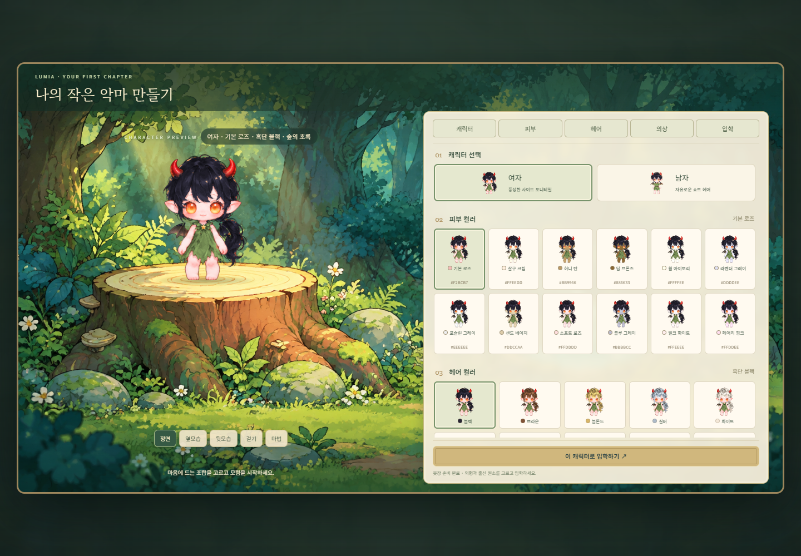
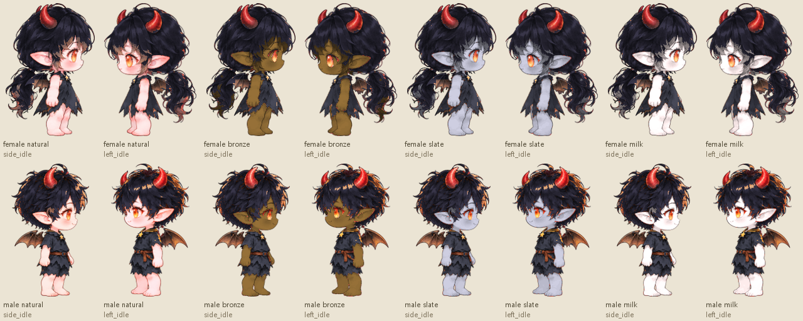

# 루미아 마법학교 — 잃어버린 별의 서

Sprite Gen 이미지와 모션으로 만든 순수 Canvas 2D 마법학교 RPG입니다. 캐릭터를 생성하고, 주민과 대화하며, 원소 수호자의 시험과 숲길 몬스터를 만납니다.



## 실행

Node.js 24.x 환경에서 실행하세요. Vercel에서도 같은 버전을 사용하도록 지정했습니다.

```bash
git clone https://github.com/minji5996-creator/game-project-test-.git
cd game-project-test-
npm ci
npm run dev
```

터미널에 표시되는 `http://127.0.0.1:5173/`을 엽니다. 게임 실행에는 이미지 생성 계정이나 API 키가 필요하지 않습니다.

```bash
npm test            # 전투 규칙·몬스터 행동 검사
npm run build      # dist/에 웹 배포용 파일 생성
npm run preview    # 빌드 결과 확인: http://127.0.0.1:4173/
npm run build:offline  # 이미지가 포함된 단일 HTML 생성
```

`build:offline` 결과인 `Lumia-Magic-Academy-2D.html`은 브라우저에서 직접 열 수 있습니다. 생성 HTML은 이미지를 중복 포함하는 큰 파생 파일이므로 Git에 넣지 않고, 필요할 때 생성합니다. `index.html`, `arcana.html`, `arcana2d.html`은 같은 게임의 진입점입니다.

## Vercel 배포

Vercel에서 이 GitHub 저장소를 **Import**하고 Root Directory를 `.`으로 둡니다. `vercel.json`과 `package.json`에 다음 설정이 포함되어 있습니다.

| 항목 | 설정 |
|---|---|
| Framework | Vite |
| Node.js | 24.x |
| Install Command | `npm ci` |
| Build Command | `npm run build` |
| Output Directory | `dist` |
| 환경 변수 | 필요 없음 |

세 HTML 진입점을 그대로 빌드합니다. 파일명에 내용 해시가 들어간 `/assets/`는 1년 캐시하고 HTML은 재검증하도록 설정했습니다. 별도의 SPA rewrite는 필요하지 않습니다. 참고: [Vercel Vite 안내](https://vercel.com/docs/frameworks/frontend/vite), [프로젝트 설정](https://vercel.com/docs/project-configuration/vercel-json).

### 로딩 최적화와 이미지 유지

- 첫 화면에는 작은 선택 카드와 현재 선택한 외형의 모션 레이어 4개만 불러옵니다. 학교 배경·몬스터는 입학할 때, 큰 NPC 일러스트는 대화할 때 불러옵니다.
- 고해상도 원본 레이어의 메모리 캐시는 최대 8개입니다. 캐릭터 생성 화면에서는 숨겨진 게임 맵 렌더링을 멈춥니다.
- 원본 PNG는 보관하고 배포에는 손실 없는 WebP를 사용합니다. 모션 프레임 크기를 유지하며 투명도와 보이는 RGB 값을 비교 검증했습니다.
- 같은 로컬 Chrome 조건에서 첫 화면의 동일 출처 자산 전송량은 **46,057,904 → 3,701,306바이트, 약 92% 감소**했습니다. 시간·LCP 측정값은 아니며, 실제 서비스 속도는 네트워크와 기기에 따라 달라집니다. 검증 기록: `docs/vercel-validation.json`.

원본 이미지를 수정했다면 아래 유지관리 명령으로 썸네일과 배포 자산을 다시 만들고, 변경된 이미지·레지스트리·매핑을 함께 커밋하세요. Vercel 빌드에서는 Python을 실행하지 않으며 이미 생성된 자산을 검증해 사용합니다.

```bash
python -m pip install Pillow
npm run optimize:assets
npm run build
```

원본과 배포 매핑이 어긋나면 빌드가 중단되므로, 오래된 배포 이미지가 조용히 반영되는 일을 방지합니다. 개발 서버와 단일 오프라인 HTML에서는 원본 PNG를 사용합니다.

JSON 원본 해시는 줄바꿈을 LF로 통일해 계산하므로 Windows와 Linux에서 동일합니다. `npm test`는 CRLF/LF 호환성과 실제 JSON 내용 변경 차단, 이미지 바이트 해시 유지도 검사합니다.

## 포함된 기능

- **16:9 캐릭터 생성 창**: 측면 숲 배경, 왼쪽 그루터기 미리보기, 오른쪽 설정 스크롤.
- **1,200가지 외형 조합**: 남녀 2종 × 피부 12색 × 머리 10색 × 의상 5색.
- 남녀 각각 **44프레임**의 4방향 대기·걷기와 마법 모션.
- 피부색별 눈 깜빡임과 좌우 측면 소재 경계 보정.
- NPC 4명의 큰 대화 일러스트, 성격별 대사와 추가 질문.
- 양장본 스타일의 인물·수호자·몬스터 도감.
- 숲길 몬스터 3종의 추격·공격 예고·복귀와 필드 마법 공격.
- 원소 상성 기반 수호자 전투, 의뢰, 상점, 물약, 경험치와 엔딩.
- 브라우저 로컬 저장과 이어하기, 이전 저장 데이터의 외형 기본값 호환.

## 조작

| 입력 | 동작 |
|---|---|
| 땅 클릭 / WASD / 방향키 | 이동 |
| NPC 그림·이름 클릭 | 다가가서 대화 |
| E | 가까운 대상과 대화·조사 |
| Enter / Space | 다음 대사 |
| Q / 원소 마법 버튼 | 가까운 필드 몬스터 공격 |
| Shift | 빠르게 이동 |
| 마우스 휠 | 확대·축소 |
| 1~8 / 전투 카드 | 수호자 전투 행동 |
| Esc | 대화·메뉴 닫기 |

모바일은 화면의 이동 패드와 행동 버튼을 사용합니다. 캐릭터 생성은 모바일에서도 16:9 창 비율을 유지합니다.

## 프로젝트 구조

- `src/arcana2d.js`: 게임 진행, 입력, HUD, 대화와 전투 연결.
- `src/arcana2d-renderer.js`: Canvas 2D 렌더링과 경로 탐색, 모션 atlas 재생.
- `src/arcana-rules.js`: 독립된 전투·보상·저장 검증 규칙.
- `src/character-creator.js`, `appearance-config.js`: 캐릭터 생성과 소재 레이어 합성.
- `src/field-monsters.js`: 필드 몬스터 행동과 공격.
- `src/npc-personas.js`, `academy-codex.js`: 주민 대화와 도감.
- `public/arcana2d/`: 캐릭터, 소재별 색상 atlas, NPC, 숲 배경과 몬스터.
- `public/arcana/`: 원소 수호자 이미지.
- `public/assets/game/`: 미리 생성한 내용 해시 기반 WebP와 manifest.
- `scripts/optimize-assets.py`: 원본 이미지의 무손실 변환과 작은 선택 카드 생성.
- `scripts/game-assets-plugin.mjs`, `asset-map.json`: 빌드 시 원본 검증과 배포 URL 교체.
- `vercel.json`: Vercel 빌드·출력·캐시 설정.
- `docs/runtime-assets.csv`: 실행 이미지·manifest의 크기와 SHA-256 목록.
- `docs/source-validation.json`: 원본 작업본에서 수행한 브라우저·소재 검증 기록.

머리·의상·피부는 베이크된 이미지 레이어이며, 외형을 선택할 때 한 번 합성한 atlas를 게임에서 재생합니다. 이미지 생성 도구는 게임 런타임에 호출하지 않습니다. 개발 시 선택지를 바꾸려면 설정 파일과 대응 이미지 자산을 함께 수정하세요.



게임 저장은 브라우저와 주소별 `localStorage`에 보관됩니다. 로그인·클라우드 저장·멀티플레이 기능은 포함하지 않습니다. 웹 배포 시에는 Vite 빌드 결과를 사이트 루트에서 제공하세요. 저장소 업로드와 웹사이트 공개 배포는 별도입니다.
